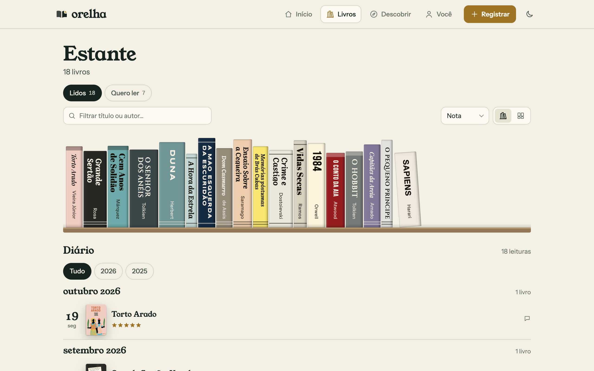
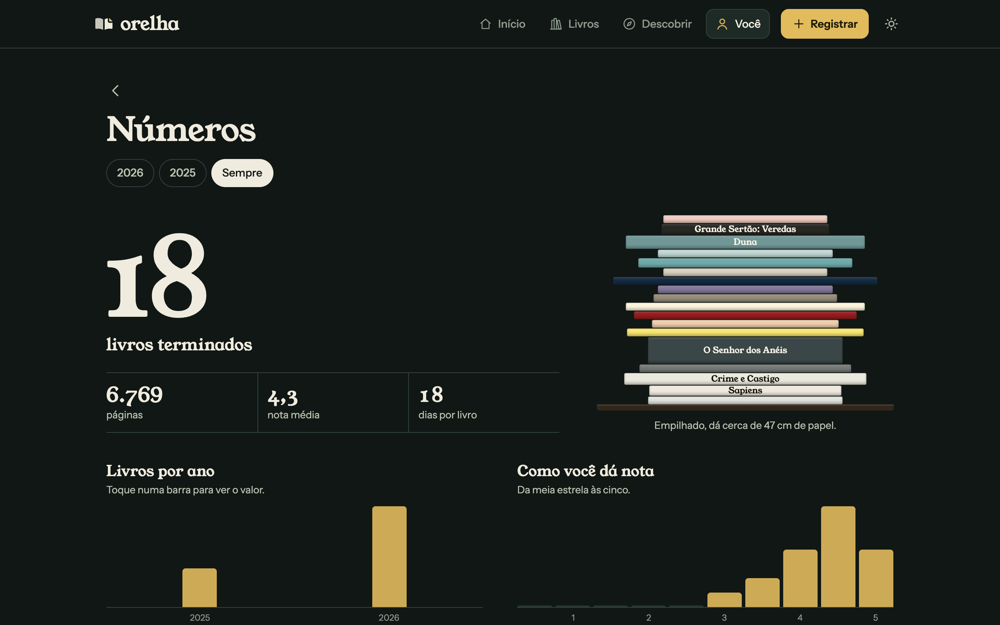

#  Orelha

Diário de leitura pessoal e estante virtual auto-hospedada. Roda localmente no seu computador (com zero dependências externas e sem etapa de build) e pode ser acessado com segurança pelos seus aparelhos na sua rede privada [Tailscale](https://tailscale.com), inclusive em modo offline somente leitura quando o computador está dormindo.



| Início (leitura atual e epígrafe) | Números da leitura e A pilha |
| :---: | :---: |
|  |  |

| Página do livro (modo escuro) | Celular / PWA (iOS e Android) |
| :---: | :---: |
|  |   |

---

## Funcionalidades

- **Estante física de lombadas:** gera lombadas proporcionais ao número de páginas, extrai automaticamente a cor dominante da capa, escolhe a tipografia pelo gênero literário e abre o livro com animação 3D ao retirá-lo da prateleira.
- **Diário de leitura completo:** notas de meia em meia estrela (½ a 5), datas de início e término, formato (`papel`, `e-book`, `áudio`), marcação de releitura e resenhas com ocultação opcional de spoilers.
- **Acompanhamento e metas:** barra de progresso por página nos livros em leitura, meta anual editável e fila de *Quero ler* sugerida direto na tela inicial quando nenhum livro está aberto.
- **Coleções e sublinhados:** seleção dos seus **4 livros favoritos**, listas personalizadas (comuns ou ranqueadas) e caderno de trechos guardados com número de página.
- **Números da leitura:** estatísticas por ano ou de todo o histórico, distribuição de notas, autores mais lidos, décadas de publicação, extremos de tamanho e **A pilha** (altura física equivalente em papel).
- **Descoberta e epígrafes:** recomendações em português baseadas no seu perfil de leitura via [Open Library](https://openlibrary.org) (com fallback na [BrasilAPI](https://brasilapi.com.br) para ISBNs brasileiros) e citações diárias vindas do [Wikiquote em português](https://pt.wikiquote.org).
- **Portabilidade total:** importação idempotente de históricos em CSV do **Goodreads** e do **StoryGraph** (com busca gradual de capas em segundo plano) e exportação completa em CSV ou JSON.
- **PWA e modo offline:** instalável na Tela de Início do iOS/Android, com tema claro/escuro automático ou manual e cache via Service Worker para consulta mesmo com o servidor desligado.

---

## Requisitos

- **Node.js 24 ou superior** (utiliza o módulo nativo `node:sqlite` — não há `node_modules` nem `npm install`).
- *(Opcional)* **Tailscale** no computador servidor (macOS ou Linux) e nos aparelhos clientes, para acesso remoto via HTTPS restrito à sua tailnet.

---

## Primeiros passos

Clone o repositório e inicie o servidor local:

```sh
git clone https://github.com/brunomartinsmv/orelha.git
cd orelha

npm start        # abre em http://localhost:4173
```

Comandos úteis durante o uso ou desenvolvimento:

```sh
npm run dev      # inicia com recarregamento automático (node --watch)
npm run demo     # popula a estante com livros e leituras de exemplo (reversível pelo botão "Começar do zero")
npm test         # executa a suíte de testes automatizados
```

---

## Acesso pela Tailnet

O servidor HTTP escuta **exclusivamente em `127.0.0.1`**. Para acessá-lo do celular sem expor nada à internet pública, o projeto usa o `tailscale serve` com HTTPS aliado a uma lista explícita de dispositivos permitidos.

O Orelha roda em **um só computador** (o servidor), que guarda o único banco de dados. Os outros aparelhos (celular, outro notebook) são clientes: abrem o endereço da tailnet no navegador ou como PWA e não instalam nada. Rodar o servidor em dois computadores criaria dois bancos separados, sem sincronização.

> **Já tem o Orelha rodando nesse computador?** Não clone de novo: os dados ficam em `data/` dentro da instalação atual, e um clone novo começa vazio. Entre na pasta que já existe e rode `scripts/servico-linux.sh atualizar` (ou `scripts/servico.sh atualizar` no macOS). O `instalar` recusa seguir quando percebe esse caso.

1. No computador que vai servir, faça um clone fixo (por exemplo `~/orelha`, não um worktree: os dados ficam em `data/` dentro dele) e crie a configuração a partir do modelo:

   ```sh
   cp config.example.json config.json
   ```

2. Edite o `config.json` com o domínio da máquina servidora na tailnet e os IPs Tailscale (IPv4 e/ou IPv6) de cada aparelho autorizado, incluindo outros computadores que vão abrir o Orelha. Você pode consultá-los rodando `tailscale status --json`:

   ```json
   {
     "port": 4173,
     "publicPort": 8443,
     "tailnetHost": "seu-mac.tailnet-exemplo.ts.net",
     "allowedDevices": {
       "mac": ["100.64.0.10", "fd7a:115c:a1e0::10"],
       "iphone": ["100.64.0.11", "fd7a:115c:a1e0::11"]
     }
   }
   ```

3. Instale o serviço em segundo plano. Os dois scripts têm os mesmos comandos:

   | Comando | O que faz |
   | --- | --- |
   | `verificar` | confere Node 24+, Tailscale, `config.json` e testes, sem mudar nada |
   | `instalar` | verifica, registra o serviço, espera o servidor responder e ativa HTTPS na porta `publicPort` |
   | `atualizar` | testa a versão nova numa cópia à parte, faz backup, avança o branch e reinicia; se a versão nova não subir, volta para a anterior |
   | `backup` | copia o banco e as capas enviadas para fora do projeto (o `instalar` já liga um backup diário) |
   | `reiniciar` | reinicia e confere se o servidor voltou |
   | `status` | estado do processo, versão no ar e `tailscale serve` |
   | `logs` | acompanha o log do servidor |
   | `remover` | desativa o serviço (seus dados em `data/` são preservados) |

   **macOS** (LaunchAgent, log em `data/orelha.log`):

   ```sh
   scripts/servico.sh instalar
   ```

   **Linux** (serviço de usuário do systemd, log no `journalctl`):

   ```sh
   sudo tailscale set --operator=$USER   # uma vez: deixa seu usuário configurar o tailscale serve sem sudo
   scripts/servico-linux.sh instalar     # também liga o linger, para o Orelha subir no boot sem login
   ```

   Num notebook servindo o Orelha, impeça que ele suspenda ao fechar a tampa: em `/etc/systemd/logind.conf`, defina `HandleLidSwitch=ignore` e `HandleLidSwitchExternalPower=ignore`, e depois rode `sudo systemctl restart systemd-logind`.

4. Abra `https://<tailnetHost>:<publicPort>` no Safari do iPhone e use **Compartilhar → Adicionar à Tela de Início** para usá-lo como aplicativo nativo.

### Atualizando e lançando versões

Para levar uma nova versão ao computador que serve o Orelha:

```sh
scripts/servico.sh atualizar        # macOS
scripts/servico-linux.sh atualizar  # Linux
```

Para lançar uma versão:

1. Mova as entradas de **[Não publicado]** no [CHANGELOG.md](CHANGELOG.md) para uma nova seção com número e data.
2. Atualize `version` no `package.json`; é a única fonte da versão (o `User-Agent` e o `/api/health` a leem dali).
3. Se a lista de arquivos do app mudou, ajuste `SHELL_FILES` e suba `VERSION` em `public/sw.js`.
4. Faça o commit, crie a tag anotada (`git tag -a v1.2.3 -m v1.2.3`) e envie com `git push --follow-tags`. Uma tag leve, sem `-a`, não vai junto.

### Modelo de segurança e funcionamento offline

- **Validação de origem e dispositivo:** requisições vindas do `tailscale serve` recebem o IP real do cliente no final de `X-Forwarded-For`; aparelhos fora de `allowedDevices`, `Host` desconhecidos (proteção contra *DNS rebinding*) ou escritas de outras origens recebem `403 Forbidden`.
- **Backups:** ficam em `~/.local/share/orelha/backups` no Linux e em `~/Library/Application Support/Orelha/backups` no macOS (ou em `ORELHA_BACKUP_DIR`). Continuam no mesmo disco: para sobreviver a uma pane, copie essa pasta para outro lugar.
- **Leitura com o servidor dormindo:** o Service Worker mantém a interface e a última cópia das respostas da API e capas em cache. Se o computador estiver em repouso, o app abre normalmente no celular em modo somente leitura.

---

## Privacidade e fontes externas

- Todos os seus dados ficam localmente em `data/orelha.sqlite` e as capas baixadas ou enviadas ficam em `data/covers/` (ambos ignorados pelo Git).
- Metadados de busca e capas são consultados na **Open Library** e, para ISBNs nacionais ausentes lá, na **BrasilAPI**, sendo cacheados localmente.
- A epígrafe exibida na página inicial consulta apenas títulos e nomes de autores dos livros lidos/em leitura no **Wikiquote em português** (com cache de 30 dias). Suas resenhas, notas, datas e trechos pessoais nunca saem do seu computador.

---

## Estrutura do projeto

```text
├── CHANGELOG.md             # Histórico de versões (Keep a Changelog)
├── config.example.json      # Modelo de configuração de portas e IPs da tailnet
├── server/
│   ├── index.js             # Ponto de entrada (escuta apenas em 127.0.0.1)
│   ├── version.js           # Versão lida do package.json (User-Agent e /api/health)
│   ├── app.js               # Roteador HTTP, controle de acesso, upload e cache de capas
│   ├── db.js                # Esquema SQLite nativo (node:sqlite) e transações
│   ├── library.js           # Regras de domínio: estante, diário, listas, metas e estatísticas
│   ├── openlibrary.js       # Busca e normalização de catálogo (Open Library + BrasilAPI)
│   ├── recommend.js         # Motor local de recomendações por perfil de gosto
│   ├── quotations.js        # Extração e cache diário de citações do Wikiquote
│   └── importers.js         # Parser CSV (Goodreads/StoryGraph) e enriquecimento gradual
├── public/
│   ├── index.html           # Shell da aplicação PWA
│   ├── styles.css           # Sistema visual, temas claro/escuro, livros 3D e estante
│   ├── sw.js                # Service Worker para funcionamento offline
│   └── app/                 # Interface em Preact + htm (ES Modules nativos, sem bundler)
├── scripts/
│   ├── seed-demo.js         # Popula dados de demonstração
│   ├── import-home-catalogue.js # Utilitário de importação de catálogo JSON em lote
│   ├── servico.sh           # Implantação no macOS: LaunchAgent, tailscale serve, atualização
│   └── servico-linux.sh     # Implantação no Linux: systemd de usuário, tailscale serve, atualização
└── test/                    # Testes automatizados com node:test
```
